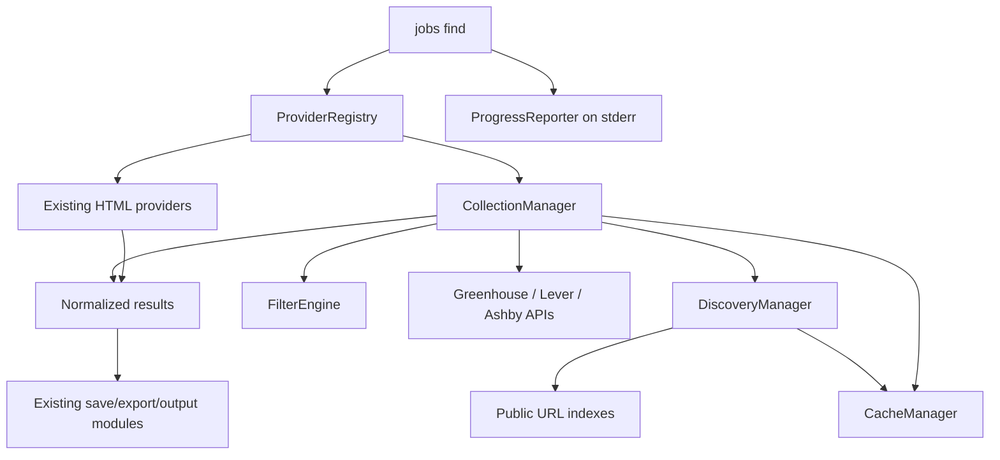

# Automatic ATS pipeline

## Components



All implementation is JavaScript. Runtime dependencies remain Cheerio, Commander,
and robots-parser; caching, scheduling, HTTP and discovery use Node standard APIs.

| Module | Responsibility |
| --- | --- |
| `src/providers.js` | ProviderRegistry, six descriptors, existing detail dispatch |
| `src/ats/*.js` | Provider URLs, JSON parsing, normalization and documented pagination |
| `src/discovery.js` | Safe board extraction, resumable indexes, validation and additive inventories |
| `src/cache.js` | Sharded versioned envelopes, locking, atomic replacement, recovery and pruning |
| `src/collection.js` | Exact-search reuse, oldest-first refresh, board snapshots, enrichment and coverage |
| `src/filter-engine.js` | Local ATS phrase/location matching, shared filter evidence and ranking |
| `src/api-http.js`, `concurrency.js` | API/index scheduling, limits, cancellation, retries, Retry-After |
| `src/progress.js` | TTY-only stderr rendering; no ownership of search state |
| `src/search.js` | Concurrent provider execution, failure isolation and stable interleaving |

## Discovery algorithm

1. Read the selected provider's inventory. Honor freshness/backoff metadata. HTML-only
   selections never instantiate this pipeline.
2. Select a full pass (30-day due interval) or recent pass (daily, using a 30-day
   capture window). Query Wayback CDX over the configured ATS hostnames with URL
   collapsing, `original` fields, a 1,000-row limit and resume keys. Process at most
   two response pages per hostname per invocation; persist cursors to continue later.
3. Decode the first path segment once; additionally recognize Greenhouse embed-board
   query tokens. Normalize Unicode and deduplicate case-insensitively within region.
   Preserve EU/global Lever identity. Reject malformed encodings, unknown hosts,
   path separators, reserved assets, tracking fragments and non-board shapes.
4. When Wayback has no successful response, try Common Crawl's current public index
   using JSONL pages and a persisted page cursor. The advertised index endpoint must
   match the official HTTPS host/path pattern. If unavailable, query one bounded
   anonymous urlscan public-search response for the selected ATS hostnames. No scan
   is submitted, and no private/authenticated index is used.
5. Validate up to eight candidates per invocation with two workers. HEAD is used
   first; unsupported/unreliable method responses (400/404/405/501) fall back to a
   JSON GET. A GET 404/410 marks a board invalid. Access restrictions, rate limits,
   server errors and network failures remain temporary. They do not erase previous
   validity. Restricted/rate-limited ATS hosts stop further new collection attempts.
6. Merge discoveries with previous inventories under a write lock. Preserve prior
   valid boards and timestamps. Completed index passes set their completion times;
   capped/failed passes retain cursors and partial coverage. A successful fallback
   inventory is reused before another daily index attempt; total index failure uses
   a shorter retry interval.

Domains: `boards.greenhouse.io`, `job-boards.greenhouse.io`, `jobs.lever.co`,
`jobs.eu.lever.co`, and `jobs.ashbyhq.com`. They are service routes, not company lists.
No company registry, curated seed, or downloaded competitive board snapshot is
bundled. The reference project's curated seed was deliberately not adopted. A
generated public snapshot was considered; no independently maintained generated
snapshot is a required dependency, so live indexes remain the source of discovery.

Archive URLs are data only. API requests are constructed from validated identifiers
on fixed HTTPS hosts. The transport rejects credentials, nonstandard ports, unsafe
encoded path separators, arbitrary destinations and redirects. Returned posting URLs
are output links; discovery never follows them to collect data.

## Cache layout and schema

Default roots:

- Windows: `%LOCALAPPDATA%/jobs-finder-cli/Cache` (user-local fallback when unset).
- macOS: `~/Library/Caches/jobs-finder-cli`.
- Linux: `$XDG_CACHE_HOME/jobs-finder-cli`, or `~/.cache/jobs-finder-cli`.

`JOBS_CACHE_DIR` is an optional deployment/test override. Saved jobs continue using
`JOBS_DB`/`LJOBS_DB`; the saved-store schema is unchanged.

Each record is `<root>/<kind>/<sha256(key)>.json`:

```json
{
  "version": 1,
  "kind": "postings",
  "key": "Greenhouse:global:example",
  "updatedAt": "2026-10-27T12:00:00.000Z",
  "expiresAt": "2026-10-27T12:20:00.000Z",
  "data": {
    "provider": "Greenhouse",
    "board": {"id": "example", "region": "global"},
    "jobs": [],
    "complete": true,
    "pages": 1,
    "content": false,
    "revision": "content-fingerprint",
    "lastSuccessfulFetchAt": "2026-10-27T12:00:00.000Z"
  }
}
```

The synthetic `example` above illustrates the format, not a configured board.

| Kind | Stored data and lifecycle |
| --- | --- |
| `inventory` | Provider, discovered boards, region/status, discovery/validation attempts, validation method/status, retry deadlines, index cursors, full/recent completion and coverage metadata. Inventory records do not expire wholesale. |
| `postings` | Full normalized board snapshot independent of query filters, completeness/page count, content capability, revision, successful fetch and per-job observation times. Fresh 20 minutes; stale retention up to 7 days. |
| `search` | Normalized semantic arguments, accepted results, warnings/coverage, inventory fingerprint and posting-shard revision references. Up to 10 minutes, shortened at job-freshness boundaries. |

Exact keys include provider selection, search/company/location, all requested
filters, strict/details, sort, result and page limits. They exclude output paths,
serialization, save intent and delay. Argument case/whitespace and object-key order
are normalized. A hit checks inventory membership/status plus referenced posting
revisions/freshness. Partial-result hits retain warnings. Date-window searches bypass
exact results and re-evaluate cached postings against the current UTC time.

Envelopes and payload shapes are validated. Corrupt records are quarantined and
replaced automatically. Writes use exclusive per-shard lock files, unique temporary
files and same-directory rename. In-process writes serialize; separate processes
merge inventories under the same lock. Old locks with dead owners recover
automatically. Once atomic replacement starts it finishes even on cancellation.
Pruning removes old search shards, posting snapshots outside stale retention, and
orphan/quarantined files while respecting writer locks. Valid inventories survive.

Temporary refresh failure leaves valid snapshots unchanged. Partial Lever pages
merge with prior entries, retaining observation times; unvisited entries are not
declared closed. Old rows expire from cache use without a closed-job inference.
Increasing a page cap refreshes insufficient truncated snapshots. Optional cache
write errors produce warnings while retaining successfully collected results.

## Scheduling and limits

Selected provider tasks run concurrently. API/index transport permits four requests
globally and two per API host, with one lane for each archive/public index host.
Existing HTML providers share a separate serialized client, giving an overall
maximum of five active HTTP lanes per process. Host starts are spaced by `--delay`;
archive minimums are 1.1 seconds and public-scan search minimums 2.1 seconds.

Requests have a 15-second body-inclusive timeout, 16 MiB decoded-response cap,
up to two transient retries with exponential backoff/jitter, and Retry-After handling
for seconds or HTTP dates. A cooldown received while a caller waits also delays that
caller. Delays beyond 30 seconds are surfaced as backoff instead of blocking the CLI
indefinitely. API 403/401 are not retried; HTML 429 is also never retried.

Collection uses two board workers per provider, at most 64 network board refreshes
per invocation and at most 200 Greenhouse detail requests. Fresh cached shards can
still be searched beyond the refresh budget. Only two posting shards are decoded
concurrently; matches are trimmed to bounded top candidates. Filtering periodically
yields for cancellation. API pagination follows `--pages`; Lever uses skip/limit.

## Normalization, filters and output

Jobs retain the existing nullable schema plus `boardId`, `region`, `providerJobId`,
`companyEvidence`, `cacheStatus`, `cacheFetchedAt`, and source timestamps. ATS IDs
include region/board/raw posting ID; saved keys remain `source:id`.

Greenhouse requests descriptions only with `--details`; date/strict enrichment
fetches matching job details as needed and reuses those details while cached. Lever
creation times and Greenhouse modification times never become posting dates. Ashby
workplace types take precedence over the ambiguous remote-eligibility boolean.
Unknown applicant/verification fields remain null. Employer names use observed
metadata when available; otherwise board labels are explicitly identified as inferred.

FilterEngine performs literal case-insensitive phrase matching over title/available
description, local location/secondary-location matching, and shared evidence-aware
criteria. It ranks each provider's accepted jobs by trustworthy posting date or
title relevance. Final output preserves existing provider-order interleaving. Specific
identical URLs can yield duplicate hints; distinct requisitions are never merged
because titles/companies happen to match.

The CLI owns SIGINT, AbortController and ProgressReporter cleanup. Diagnostics go to
stderr with bounded summaries. JSON/CSV/JSONL stdout is clean. Recognized empty
searches exit 0, all-provider failures exit 1 and cancellation exits 130.

## Primary references

- [Greenhouse public Job Board API](https://docs.greenhouse.io/job-board)
- [Lever Postings API](https://github.com/lever/postings-api)
- [Ashby Job Postings API](https://developers.ashbyhq.com/docs/public-job-posting-api)
- [Internet Archive CDX protocol](https://github.com/internetarchive/wayback/tree/master/wayback-cdx-server)
- [Common Crawl public index](https://index.commoncrawl.org/)
- [urlscan API access](https://docs.urlscan.io/pages/api-intro)
- [Reference discovery methodology](https://github.com/mherzog4/job-boards)
