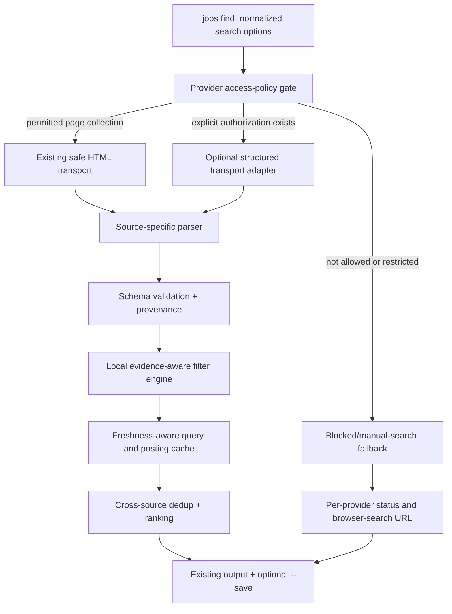

# Jobs Finder CLI — Indeed & Glassdoor Provider Engineering Specification

**Status:** Implementation-ready technical design and AI-agent execution plan  
**Research snapshot:** October 28, 2026  
**Target repository:** https://github.com/hamzavaid/jobs-finder-cli  
**Languages:** JavaScript (ES modules), Node.js 20+, existing Cheerio/Commander infrastructure  
**User-facing interface:** `jobs find` (do not require new discovery/sync commands)  
**Priority order:** correctness → responsible access → reliability → speed → coverage

> **Critical feasibility boundary:** Indeed and Glassdoor restrict automated collection and can return HTTP 403/429 or challenge pages. The reference repositories demonstrate techniques but do **not** establish reliable, unrestricted or authorized access. No API key is required for the designs here, but **no API key** does not imply permission. This specification deliberately separates parsers/search semantics that can be fully implemented and tested from network access that must be confirmed as permitted. Never claim an access-denied provider successfully returned zero matches, nor substitute listings from another source and label them Indeed/Glassdoor.

---

## 1. AI agent mission and acceptance definition

Improve the **existing** Indeed and Glassdoor provider modules. Do not rebuild the CLI or overwrite working LinkedIn/ATS integrations. Make searches more precise, faster where possible, resilient to markup/schema drift, transparent when access is blocked, and compatible with the existing normalized-job/filter/cache/output architecture.

### Mandatory constraints

1. Stay in Node.js/JavaScript. Avoid Python or a separate long-lived service.
2. No paid scraping service, external API keys, subscriptions, compulsory accounts, residential proxies, stealth plugins, fingerprint spoofing, CAPTCHA solving, login bypasses or access-control circumvention.
3. Do not assume an undocumented JSON/GraphQL interface is an unrestricted public API. **Enable structured transport only with documented authorization for that access**, otherwise retain it as an inactive, tested capability/reference design.
4. Check the sites' current terms and applicable access rules before enabling automated requests; implement per-provider access policy. Honor HTTP blocks and `Retry-After`. Do not automatically switch to an alternative route after a block to evade the decision.
5. Preserve all currently available CLI commands and `jobs find` flags; do not break existing saved jobs, CSV/JSON fields, or other providers.
6. No silent filter drops, guessed dates, invented applicant counts or verification badges. Use null/unknown with explicit evidence.
7. No fabricated success. Deterministic tests establish parser behavior; live results establish real collection success **only on explicitly permitted access paths**.

### Definition of done

- An **accessible and permitted** Indeed/Glassdoor search returns normalized valid job records, uses supported filters accurately, paginates within request budgets, preserves provider identity and handles partial results correctly.
- An inaccessible site produces `blocked`/`restricted` status with an actionable diagnostic and no false `empty` result; other selected websites continue normally.
- Parsed and normalized data pass fixture tests; search and CLI integration tests run offline; permitted live smoke tests are separated from CI.
- A repeated same-query search reuses a freshness-checked cache, does not repeat unnecessary requests, and does not reuse a cached access denial as job data.
- All provider-specific behavior stays behind `jobs find`, with clean output to stdout and minimal progress on stderr.

---

## 2. Reference implementations and what to learn from each

| Repository | Relevant strategy | Use in this project | Do not assume |
|---|---|---|---|
| [ShenoudaGergis/indeed-job-scraper](https://github.com/ShenoudaGergis/indeed-job-scraper) | Puppeteer loads `/jobs`; Cheerio parses cards and next-page links; search URL supports `q`, `l`, `explvl`, `jt`, `fromage`, `sort` | Historical query-parameter mappings; DOM parser structure | Last change May 2023; issue [#4](https://github.com/ShenoudaGergis/indeed-job-scraper/issues/4) reports CAPTCHA/empty results. Do not copy stealth layer or stale selectors as proof of success |
| [speedyapply/JobSpy](https://github.com/speedyapply/JobSpy/tree/main/jobspy/indeed) | Indeed structured job search, cursor navigation, typed attributes, job type/remote/date extraction | Data-model design; cursor pagination contracts; field handling | Python runtime or undocumented Indeed API is not a supported CLI dependency |
| [alpharomercoma/ts-jobspy](https://github.com/alpharomercoma/ts-jobspy/tree/main/src/indeed) | TypeScript data contracts, bounded pages, per-site errors, explicit dropped-filter reporting, dedupe | Primary JS/TS reference for Indeed semantics and observability | Its working Indeed health check does not imply access in every environment |
| [DaKheera47/jobspy-node](https://github.com/DaKheera47/jobspy-node/tree/main/src/sites/indeed) | Separate request builder, transport and parser | Modular source layout; validation and normalization tests | It is not independent live-access verification |
| [borgius/jobspy-js](https://github.com/borgius/jobspy-js/tree/master/src/scrapers) | Cross-site normalized records, search profiles, pagination and detail enrichment | Data modeling and optional field enrichment | Do not copy unneeded proxies/login/hidden endpoints |
| [speedyapply/JobSpy Glassdoor](https://github.com/speedyapply/JobSpy/tree/main/jobspy/glassdoor) | Search variables, location identifiers, filter groups, cursor pagination, batch details | Study schema and filter logic; understand structured pagination | Current endpoint access and permission are not established |
| [ts-jobspy Glassdoor](https://github.com/alpharomercoma/ts-jobspy/tree/main/src/glassdoor) | Location resolution, job card/detail separation, error classification, detail budgets | Main Glassdoor architectural reference | [Oct. 28 health check](https://github.com/alpharomercoma/ts-jobspy/actions/runs/40693325586) reported HTTP 403 / zero Glassdoor results |
| [falkenbach/actor-glassdoor-jobs](https://github.com/falkenbach/actor-glassdoor-jobs) | Embedded Apollo JSON and JSON-LD page extraction | Parser fallback ideas and salary attribution | Old Apify-dependent implementation; not reliable proof of current access |
| [AnkurNapa/jobgrab](https://github.com/AnkurNapa/jobgrab/blob/main/content/scraper-glassdoor.js) | User-initiated extraction of JSON-LD, DOM and listing IDs from already opened pages | Optional manual import; validation of on-page structured data | Does not implement unrestricted, automatic bulk search |

**Observed health evidence, not a guarantee:** ts-jobspy's October 28, 2026 CI reported five Indeed jobs in a successful smoke check, while Glassdoor returned HTTP 403. That test is not a substitute for permission, locale/keyword testing or performance measurement on this CLI.

**Source policy documents:** [Indeed Terms](https://www.indeed.com/legal?hl=en_US) (updated September 29, 2026); [Glassdoor Terms](https://www.glassdoor.com/about/terms-2022-12-01/) (historical text documents express-permission restrictions; check the current terms before deployment). Review site robots rules in addition to terms. Record the evaluation and any explicit authorization in `docs/PROVIDER_ACCESS.md` without storing credentials there.

---

## 3. Inspect the current repository *before* coding

The source tree has evolved beyond the earlier three-provider version. First inspect the current `main` branch and these files (do not assume earlier line numbers are still valid):

| File | Existing responsibility | Requested change |
|---|---|---|
| `src/indeed.js` | `/jobs` URL parameters, `window.mosaic.providerData` and `_initialData` extraction, HTML fallback, detail parsing | Separate search semantics, parser variants, date evidence, and defensive pagination |
| `src/glassdoor.js` | Public SEO route, JSON-LD/HTML cards, detail parsing, robots check, next links | Improve URL/location fidelity where verified, ID formats, structural detection and robots caching |
| `src/provider-search.js` | Shared HTML pagination, detail enrichment, filtering, partial result handling | Add transport-independent search-page result interface if necessary; do not duplicate logic |
| `src/http.js` | Public HTML transport, timeouts, body limits, restricted status handling | Keep this as the permitted-page transport; reuse cancellation and scheduler |
| `src/filters.js`, `src/relevance.js` | Search/filter normalization, local matching, evidence rules | Per-provider support maps; accurate `--strict` semantics |
| `src/schema.js`, `src/posting-parser.js` | Normalized job model, schema versions, structured `JobPosting` data | Robust input validation, observed data and provenance |
| `src/cache.js`, `src/resolution.js` | Cache records, resolution metadata, invalidation | Provider HTML result cache, structural-parser versioning, block cooldown |
| `src/search.js`, `src/providers.js` | Orchestrate providers and merge/rank jobs | Keep independent failure isolation and global ranking |
| `src/progress.js`, `src/cli.js` | TTY progress, commands/options | Show concise provider status without extra user commands |
| `test/indeed.test.js`, `test/glassdoor.test.js`, `test/multi-provider.test.js` | Existing parser and integration tests | Extend with realistic, authorized or synthetic variants and failure cases |

**Baseline gate:** `npm ci`, `npm run lint`, `npm test`. Record results and repository commit SHA in `docs/INDEED_GLASSDOOR_AUDIT.md`. Inspect current provider behavior and use the existing normalizer/cache; don't add a redundant global transport or separate user command.

---

## 4. Target architecture



### Suggested internal module boundaries (only add modules if they reduce complexity)

```text
src/
  indeed.js                   # Existing facade and parser exports
  glassdoor.js                # Existing facade and parser exports
  provider-search.js          # Existing bounded search loop
  provider-access.js          # NEW: source permission and transport capability gate
  provider-result.js          # NEW or existing: shared states, reason codes, metrics
  provider-filter-map.js      # NEW: explicit supported / partial / unsupported mapping
  providers/
    indeed-query.js           # OPTIONAL: pure URL/query builder
    indeed-normalize.js       # OPTIONAL: parse/mapping helpers
    glassdoor-normalize.js    # OPTIONAL: parse/mapping helpers
  test/...                    # Fixtures and integration tests
```

Prefer keeping small changes inside existing files if extra modules would merely move a few lines. Use the existing `createHttpClient`, `CacheManager`, `evaluateJob`, `normalizeJob`, `searchProvider` and `ProgressReporter` unless a test shows an incompatibility.

### Capability abstraction

Each provider should describe *what it can genuinely do*, not what an upstream project once did:

```js
// DESIGN CONTRACT — illustrative, not a drop-in replacement for current exports.
const providerCapabilities = {
  name: 'Indeed',
  access: 'permission-required',
  transports: ['public-html', 'authorized-structured', 'manual-link'],
  searchFilters: {
    search: 'supported',
    location: 'supported-when-server-honors',
    date: 'coarse-when-observed',
    employment: 'partial',
    remote: 'partial',
    workplace: 'partial',
    company: 'local',
    experience: 'partial',
    under: 'unsupported',
    verified: 'unsupported'
  }
};
```

`authorized-structured` must be **disabled by default**; activation requires a documented permission/contract and supported interface. There is no auto-fallback from a 403 to an undocumented endpoint.

---

## 5. Shared provider lifecycle: exact operational steps

For each selected `Indeed` or `Glassdoor` provider, execute:

1. **Normalize input** with existing `normalizeOptions`: validate keyword, location, date duration, `--limit`, `--pages`, `--delay`, `--strict`, output mode, boolean flags; canonicalize provider name.
2. **Select the permitted mode** from the provider access policy. Do not assume that a public URL implies permitted automation. In a denied/unapproved environment, skip automated collection and offer browser-search URL, preserving status.
3. **Compute a stable query key** from `provider`, normalized criteria, locale/domain, sort, requested page budget and parser version. Do not include unrelated providers, output path or save flag.
4. **Try a fresh result cache** only if it was produced by actual successful/partial parsing for the same source and filter evidence. Never reinterpret a cached 403 as `empty`.
5. **Build the search request** using independently verified, publicly permitted route(s); encode all user strings with `URLSearchParams`. Do not concatenate unchecked user input into paths or JS/GraphQL strings.
6. **Fetch within a budget:** explicit timeout, response-size limit, one or low bounded concurrent requests, backoff on transient 5xx and 429. Stop on 401/403 or challenge; no retry cascade or route hopping.
7. **Classify the response before parsing.** Reject login pages, CAPTCHA/challenge markup, HTML masquerading as JSON, malformed pages and absent expected result containers. Separate a genuine recognized empty state from schema drift.
8. **Parse job cards:** prefer valid structured on-page data; fall back to documented DOM variants; preserve one canonical job per stable source ID. Catch malformed individual cards without silently accepting them.
9. **Optionally enrich details:** only candidate jobs requiring full descriptions, dates or other requested fields; bounded requests, same access rules, cache by canonical source ID and parser version.
10. **Apply filters locally:** hard contradictions reject; unsupported/unknown criteria remain unknown and are excluded when the requested criterion cannot be demonstrated. Track server-facet reliance separately.
11. **Paginate** with a verified next link or documented cursor only. Stop at `--limit`, `--pages`, repeated cursor/URL, recognized end-of-results, cancellation or access block.
12. **Normalize + validate** source IDs, links, date precision, salary units, source evidence and description completeness. Preserve partial results when a later page fails; no duplicate resurrection.
13. **Commit cache atomically** for successful or honest partial outcomes; track freshness and incomplete coverage. Set provider cooldown separately for blocks.
14. **Report** `ok`, `empty`, `partial`, `blocked`, `restricted`, `schema_changed`, `rate_limited`, `timeout`, or `failed`, with counts, duration, pages and unsupported criteria.
15. **Return to orchestrator:** never terminate other selected sites. Merge/rank only genuine returned records; write progress/errors to stderr and structured jobs to stdout.

### State machine

```text
START
  -> ACCESS_CHECK
     -> NOT_PERMITTED -> RESTRICTED (0 jobs, no scraping)
     -> PERMITTED -> CACHE_CHECK
        -> FRESH_CACHE -> RESULTS (annotated cache hit)
        -> MISS -> FETCH_PAGE -> RESPONSE_CLASSIFY
             -> HTTP_401/403/CHALLENGE -> BLOCKED (partial if earlier pages exist)
             -> HTTP_429 -> RATE_LIMITED (respect Retry-After; partial if earlier data)
             -> NETWORK/TIMEOUT -> RETRY_BOUNDED or FAILED/PARTIAL
             -> RECOGNIZED_NO_RESULTS -> EMPTY
             -> UNRECOGNIZED_PAGE -> SCHEMA_CHANGED
             -> PARSE -> VALIDATE -> FILTER -> MAYBE_ENRICH
                  -> NEXT_PAGE? FETCH_PAGE
                  -> END -> CACHE_WRITE -> OK/PARTIAL
```

### Required result envelope

```js
{
  provider: 'Glassdoor',
  status: 'partial',            // one of the explicit states above
  jobs: [],                    // only jobs demonstrably collected
  pagesAttempted: 2,
  pagesParsed: 1,
  cardsSeen: 18,
  jobsAccepted: 12,
  errors: [{ code: 'HTTP_403', page: 2, message: 'Access restricted' }],
  unsupportedFilters: ['verified'],
  unconfirmedFilters: [],
  nextPageAvailable: true,
  complete: false,
  fromCache: false,
  durationMs: 1632,
  accessMode: 'public-html',
  observedAt: '2026-10-28T20:00:00.000Z'
}
```

Example only; never invent runtime counts. Use existing stats type if equivalent; avoid changing exported JSON schema gratuitously.

---

## 6. Indeed: detailed implementation pipeline

### 6.1 Search-query construction

Keep the existing public `/jobs` URL builder in `src/indeed.js`. Validate parameter applicability before constructing a URL:

| CLI argument | Public-search concept | Treatment |
|---|---|---|
| `--search` | `q` | URL-encoded keyword/phrase; let Indeed decide text search scope |
| `--location` | `l` | Encode user location; confirm result location locally when observed |
| `--date` | Coarse `fromage` day bucket, where publicly supported | Round bucket **outward**, then verify exact requested hours locally if posting timestamp is available; otherwise uncertain |
| `--employment` | `jt` for known types | Use explicit mapping; don't silently map unsupported types |
| `--experience` | `explvl` when supported | Treat server use as unconfirmed unless observable metadata corroborates |
| `--remote` / `--workplace` | Known UI facets only when publicly permitted and verified | Validate exact remote vs hybrid vs onsite locally; do not infer hybrid from `isRemote=true` |
| `--company` | Company UI facet or query hint | Enforce actual observed company match locally; don't assume query hint is exact |
| `--sort` | `sort=date` / default relevance | Report whether sort order was observed/honored |
| `--pages` | Public `start` offset or actual next link | Detect repeated pages and stop; dedupe by stable job key |
| `--under`, `--verified` | No trustworthy values available | Return unknown; required values exclude jobs rather than fabricating truth |

**Procedure:**

1. Maintain an explicit mapping table from normalized filters to observed Indeed URL parameters, with source/test evidence and last review date.
2. Convert `--date` to a supported bucket only if mapping is confirmed. A `24h` requirement cannot be proven by a two-day bucket alone.
3. Prefer a real parsed next-page link where available; otherwise use the already tested `start` offset carefully. The offset is not a guarantee of stable pagination.
4. Never silently drop an employment/remote/date restriction; collect `unsupportedFilters` and `unconfirmedFilters` and apply local evaluation.
5. Preserve the user keyword string for provider-side searching, but keep local matching semantics explicit. Indeed search may match descriptions as well as titles; do **not** impose unintended title-only filtering unless the CLI already promises it.

### 6.2 Public-response parsing (primary permitted route)

**Order of evidence:** recognized in-page structured job data → known HTML cards → recognized no-results marker → parser error. Do not evaluate scripts.

Current code already reads `window.mosaic.providerData["mosaic-provider-jobcards"]` and `window._initialData`. Improve it as follows:

1. Recognize a small set of *observed* script assignments and JSON `<script>` nodes, each with a separate fixture.
2. Use bounded balanced-JSON extraction or JSON parse only. Never `eval`, `Function`, script execution, or arbitrary recursive traversal without depth/item caps.
3. Locate typed candidate arrays with expected keys (`jk`/`jobkey`, job title and employer), **not** any object that happens to have an `id` field. Limit nested objects, JSON byte sizes and recursion depth.
4. In each candidate, require a valid job key, nonempty title, nonempty company or explicit unknown, and an allowed canonical URL. Quarantine malformed objects and increment `schemaRejected`.
5. Normalize structured attributes: employer identity, title, location, compensation, employment type, remote signal, description completeness, and trustworthy posting date.
6. If structured data is absent, use scoped job-card selectors such as validated `[data-jk]` containers and current observed data-test variants; avoid global selectors that accidentally capture navigation cards.
7. If both sources expose the same job, reconcile by stable Indeed job key, preferring observed non-null fields and retaining provenance; don't concatenate contradictory salary/date values.
8. If a successful-looking HTML page yields zero cards but lacks an explicit empty-state element, classify as `schema_changed` or `blocked`, **not** `empty`.

### 6.3 Posting-date semantics

- Prefer **date added to Indeed** only when available as a trustworthy source timestamp. `datePublished` and `dateOnIndeed` can have different meanings; preserve both if observed rather than choosing blindly.
- A valid ISO timestamp with timezone is `datePrecision='instant'`.
- A valid date-only value is `datePrecision='day'` and must be evaluated with timezone uncertainty.
- Relative strings such as `3 days ago` belong in `postedText`; do not convert to an exact UTC timestamp unless the source gives a reliable anchor and semantics.
- Cache timestamp (`fetchedAt`) is **not** publication date. Missing posting dates remain null and must not satisfy a strict `--date` request.

### 6.4 Job detail enrichment

Only request a detail page if its source is permitted, the job is plausibly relevant, the candidate needs a missing field and there is remaining budget. On details:

1. Validate same Indeed job key/domain; prohibit cross-job merge.
2. Prefer JSON-LD `JobPosting` and validated detail DOM fields.
3. Sanitize HTML to plain text; limit response size and parser depth.
4. Preserve the card if a nonfatal detail request fails; set `resolutionStatus='incomplete'`, include a warning and do not invent fields.
5. Cache details by `Indeed:{jobKey}:parserVersion`, with evidence and refresh time; do not cache challenge markup as details.

### 6.5 Structured-search strategy found in JobSpy (research-only unless authorized)

The recent JobSpy and ts-jobspy implementations employ an **unofficial Indeed GraphQL job-search interface** rather than relying on `/jobs` HTML. Their general data flow is:

```text
validated search input
  -> structured query builder (keyword, locale, location, time/job-type flags)
  -> authorized structured search response
  -> nested results / pageInfo.nextCursor
  -> model validation and normalization
  -> deduplication and remaining-filter verification
  -> next cursor if budget permits
```

**Implementation steps if—and only if—access is explicitly authorized:**

1. Confirm the authorized endpoint, method, response contract, terms, locale support, rate limits and allowed authentication mechanism with the provider; document evidence.
2. Build an independent adapter implementing the existing provider result contract rather than replacing the HTML adapter.
3. Validate/safely serialize user keyword, location, and cursor strings; reject malformed/oversized values.
4. Parse the response using a versioned schema; detect missing `results` and `nextCursor` as schema drift, not zero matches.
5. Page until the next cursor is missing/repeated, the result cap is met, or the request budget is reached.
6. Report when two requested server filters cannot be represented together; apply only verifiable missing filters locally.
7. Enforce the same normalization, cooldown, cancellation and cache rules as HTML.
8. Keep this adapter behind an access-policy feature gate; never use mobile-app impersonation, copied authorization tokens or undocumented access as an automatic 403 workaround.

**Filter composition warning:** ts-jobspy reports limitations combining certain Indeed date, easy-apply and employment/remote filter groups. A client must validate which restrictions were actually applied, then truthfully report omissions. Do not assume every structured filter can be combined.

### 6.6 Indeed regression test catalog

- Search URL encoding: quoted phrase, ampersand, Unicode, apostrophes, parenthesis, spaces, malicious-looking strings, empty query plus company/location.
- `fromage`: exact 1d, multi-day and subday; no claim a rounded bucket proves exact age.
- DOM fixture v1/v2; embedded structured payload v1/v2; duplicate card-and-JSON conflict; relative date only; HTML detail with JSON-LD.
- No jobs recognized; challenge HTML; login redirect; HTTP 401/403/429; HTTP 200 with HTML masquerading as JSON.
- No `jk`; inconsistent job IDs; wrong employer; invalid URL; missing title; invalid timestamp and truncated JSON.
- Pagination with repeated offset/page, duplicate jobs, no next link, partial page, later-page error, and cancellation.
- Search/description evidence, unknown `--under`/`--verified`, remote vs hybrid, date precision and `--strict`.

---

## 7. Glassdoor: detailed implementation pipeline

### 7.1 Public search-route and geographic scope

The existing `makeGlassdoorUrl()` builds a keyword SEO route but does **not** currently encode the CLI location. Implement this correctly only after finding an **observed, permitted** route format. Do not invent location IDs or synthesize undocumented URL fragments.

1. Validate the keyword and location parameters independently.
2. Construct URLs using an allowlisted Glassdoor hostname and vetted path patterns.
3. If location cannot be expressed server-side, mark `locationServerApplied=false`, and warn that local filtering may be incomplete because jobs outside the initial search scope are invisible.
4. When a structured location lookup is legitimately authorized, validate selected city/state/country identity and ambiguity. Never silently select the first similarly named city.
5. Validate a public next-page link and follow only approved Glassdoor paths. If pagination is client-only, mark `paginationUnsupported`/`partial` and stop rather than guessing the request.

### 7.2 Public page parsing (primary permitted route)

**Priority:** valid `application/ld+json` `JobPosting` → embedded server-rendered JSON with known, tested schema → scoped DOM selectors → recognized empty-state → parser error.

The older `actor-glassdoor-jobs` project demonstrates embedded Apollo data; `jobgrab` demonstrates user-initiated JSON-LD/DOM extraction. Treat these as **parser references**, not permission to collect pages or to call private APIs.

Implementation steps:

1. Retain the existing robots/terms access gate and cache the robots policy response for an appropriate TTL (for example, six hours), with safe failure behavior; do not fetch robots on every job card.
2. Parse JSON-LD `JobPosting` nodes and `@graph` collections with bounded nesting, ensuring the record refers to the source page/listing.
3. Extract stable Glassdoor listing ID: prefer validated `jl`/`jobListingId` query parameters; add any other URL-ID patterns **only when confirmed in fixture tests**. Do not derive identity from a title slug.
4. Parse individual cards using scoped, versioned selectors, not broad page-wide matches. Validate title, employer, URL, location and optional metadata.
5. Handle salary as an evidence-rich object: range min/max, currency, periodicity, and whether it is employer-provided or Glassdoor-estimated. Do not label an estimate as guaranteed compensation.
6. Preserve employment type as source text plus a normalized code when known. Remote/hybrid/onsite should remain unknown unless explicitly substantiated.
7. If the card has no trustworthy publication date, keep `postedAt=null`. If source metadata reports `ageInDays`, retain it as a **coarse age**, not an exact timestamp.
8. Use the existing `parseGlassdoorDetail` only for requested/missing information, with the same-ID check before merging.
9. Detect client-rendered placeholders and login/challenge/interstitial pages; distinguish them from truly empty results.
10. Stop safely on robots restriction, site block or unsupported pagination; annotate status and retain any previously collected results.

### 7.3 Structured search approach in modern JobSpy (research-only unless authorized)

Recent JobSpy implementations model Glassdoor's internal search as a structured pipeline involving location resolution, a search operation, opaque page cursors and detail operations. These are **not public, keyless APIs with established permission**.

The architectural concepts worth reusing are:

```text
keyword + geographic criteria
  -> verify supported location scope
  -> authorized structured query
  -> normalized listing summaries
  -> page cursor and dedup
  -> bounded, selective description enrichment
  -> evidence-aware local filters
```

If explicit authorization for the interface is obtained:

1. Document the authorized URL, operation contract, request method, permissible access, and rate limits.
2. Use a typed schema to validate summary records (`listingId`, job title, employer, location, salary metadata, remote/workplace, age/date).
3. Request a bounded page; only follow a cursor returned by a valid response and reject repeated cursors.
4. Apply filters only to the extent the authorized schema supports them. Report unsupported/dropped restrictions.
5. Fetch descriptions only for candidates that remain after inexpensive filters, in low bounded concurrency and within a separate detail budget.
6. Preserve a valid summary when description enrichment fails; record the resulting `partial` status.
7. Do not copy CSRF tokens, cookies, browser-fingerprint headers or private operation signatures from upstream repositories as an access-control workaround. If access fails, report it; don't attempt an evasive fallback.

### 7.4 Browser-assisted option, without a new command

A user-initiated import is a practical fallback for restricted public collection. Keep it inside `jobs find` as an **optional** workflow rather than introducing an obligatory `jobs sync`/`jobs import` command.

- When automated Glassdoor collection is blocked, print a properly constructed public search URL and a one-line reason on stderr.
- Optionally support a clearly labeled flag or interactive prompt to open the public search in the user's browser **only on an interactive terminal with user consent**.
- If the user manually saves a page or explicitly imports an exported listing, parse that supplied content with the same Glassdoor parser and provenance tag `user-supplied`, not `automated-live`.
- Never access logged-in browser profiles, extract cookies or automate navigating restricted pages without specific authorization.
- This is useful for an individual listing, but is **not** a substitute for automatic platform-wide search.

### 7.5 Glassdoor regression test catalog

- SEO keyword route and safe URL encoding; location correctness/non-representability; host allowlist and redirect refusal.
- `JobPosting` singleton, list, `@graph`, malformed JSON-LD and DOM fallback.
- Valid `jl`, alternate observed listing URL patterns, missing `jl`, conflicting IDs, wrong detail page.
- Salary employer/estimated attribution, hourly/annual/currency handling, missing salary.
- Observed workplace types, missing workplace, date-only vs coarse `ageInDays`, company/region metadata.
- Robots allowed, disallowed, stale/fetch failure, cached same-policy reuse.
- Public next anchor, repeated next link, client-only show-more, max pages.
- HTTP 403/429, login wall, CAPTCHA, non-job JSON, 200 empty HTML, known no-results component.
- Partial extraction after detail failure; no false successful empty searches; other selected providers continue.

---

## 8. Unified filter semantics (do not silently weaken searches)

The CLI accepts broad standardized filters; each source has different metadata and publicly observable behavior. Use the existing `evaluateJob` to preserve the distinction among **verified match**, **verified contradiction**, **unknown**, and **server-applied but unconfirmed**.

| User filter | Indeed | Glassdoor | Required local verification |
|---|---|---|---|
| `--search` | Public `q` / observed keyword field | SEO keyword / authorized query | Search matching scope defined; no silent reinterpretation |
| `--location` | Public `l`, then observed place | Local observed place; server route only when confirmed | Distinguish city/state/country ambiguities; don't silently claim geographic radius |
| `--date Nh/Nd/Nw` | Coarse buckets or observed timestamp | Coarse days or observed timestamp | Exact window only if timestamp precision permits |
| `--company` | Query hint and normalized observed employer | Observed employer name | No false exact match from a token/slug |
| `--employment` | Some publicly observable `jt` mappings | Observed job type / permitted filter | Reject unknown requested employment types |
| `--experience` | Sometimes observed level/taxonomy | Often unavailable | Unknown unless supported data shows level |
| `--remote` | Some filters and observed remote signals | Observed workplace metadata | `remote=true` must not silently include hybrid |
| `--workplace` | Only with observed evidence | Only with observed evidence | Exact enum when possible |
| `--under` | No reliable applicant count | No reliable applicant count | Unsupported; do not invent counts |
| `--verified` | No reliable job-verification flag | No reliable job-verification flag | Unsupported; an employer URL alone is not this flag |
| `--sort recent` | Server hint if accepted; local sort over trusted timestamps | Local date ordering when trustworthy | Unknown dates must not be labeled newest |

**Decision contract:**

```js
// PSEUDOCODE: adapt to existing evaluateJob API.
function decideFilter(requested, observed, serverFacetConfirmed) {
  if (requested === undefined || requested === null) return 'not-requested';
  if (observed === requested) return 'verified-match';
  if (observed !== null && observed !== undefined) return 'verified-mismatch';
  if (serverFacetConfirmed) return 'unconfirmed-server-facet';
  return 'unknown';
}
```

If the user supplies `--strict`, reject `unknown` and `unconfirmed-server-facet` results. For unsupported `--verified` and `--under`, exclude matching claims even in normal mode unless independently observed. A source passing a filter as a query argument does **not** prove it honored the filter. Preserve original options and do not mutate them while mapping provider-specific queries.

### Keywords, phrases and tags

Retain the existing keyword grammar unless a new grammar is explicitly added and tested. Optional feature work may support `"exact phrase"`, `OR`, exclusions and parentheses for local filtering, but **do not accidentally change** plain `--search "Software Engineer"` behavior. If a provider's search syntax differs, treat it as a hint and document the supported subset. Scope user-supplied text to safe string data; no regular expression from arbitrary unsanitized input, no JS evaluation, and no query injection.

A title/description containing the keyword does not automatically imply the candidate satisfies job type, experience or remote-status tags. Evaluate those dimensions independently.

---

## 9. Pagination, budgets and termination

### Pagination contract

```js
{
  items: [/* validated normalized cards */],
  next: { kind: 'url', value: 'https://...' } | null,
  // Or, for explicitly authorized structured data:
  // next: { kind: 'cursor', value: 'opaque-cursor' }
  terminal: false,
  recognizedEmpty: false,
  completeness: 'complete-page'
}
```

1. Track visited page URLs and cursors in sets; repeated value means partial/stalled, not infinite loop.
2. Deduplicate job IDs across pages before enrichment.
3. Don't claim `complete=true` if stopped by `--pages`, transport block, unknown pagination, timeout, or parser drift while more pages could exist.
4. Keep accepted results when a later page fails. Use a bounded `--limit` and separate **page** and **detail** budgets.
5. Do not confuse `--limit` with a requirement to issue more requests until filled. An empty or blocked site should exit safely.
6. Avoid unbounded concurrency. Existing shared scheduler is preferred; at most one or two active requests per restricted HTML source.
7. Pause/back off on 429 according to `Retry-After`; for a 403/401 or recognized challenge, stop immediately rather than retrying or switching transports.
8. Global multi-provider orchestration should run independent providers concurrently but protect the total request budget.

**Suggested defaults (tune with measurements, not guesswork):** existing `--pages=5`, `--delay=1200ms`, 15-second request timeout, 16 MiB body cap; maximum 25 detail fetches per source initially. Existing CLI options should remain authoritative if they differ.

---

## 10. Data schema, identity, provenance and deduplication

Use `src/schema.js` and `normalizeJob`; the following fields are an illustrative superset, not a demand to break serialized output:

```json
{
  "source": "Indeed",
  "id": "indeed-job-key",
  "providerJobId": "indeed-job-key",
  "title": "Software Engineer",
  "company": "Example Employer",
  "location": "Los Angeles, CA",
  "url": "https://www.indeed.com/viewjob?jk=examplejobkey",
  "postedAt": null,
  "datePrecision": null,
  "postedText": "3 days ago",
  "employmentType": null,
  "seniorityLevel": null,
  "workplace": null,
  "salary": null,
  "salarySource": null,
  "description": null,
  "applicantCount": null,
  "underTenApplicants": null,
  "verified": null,
  "detailsFetched": false,
  "resolutionStatus": "incomplete",
  "filterEvidence": "observed-or-unfiltered",
  "unconfirmedFilters": [],
  "fetchedAt": "2026-10-28T20:00:00.000Z",
  "provenance": [{"source":"Indeed","method":"public-page","url":"https://www.indeed.com/viewjob?jk=examplejobkey"}]
}
```

**Important invariants:**

- Preserve source-qualified saved IDs so an Indeed job and Glassdoor job cannot collide; internal canonical key should be `source:providerJobId`.
- Same title/company/location is a duplicate **hint**, not proof of the same requisition. Prefer canonical employer posting URL or stable source ID for confident linking.
- Retain separate provenance entries when the same employer vacancy appears across multiple sources, never relabel an ATS result as a Glassdoor result.
- Preserve `firstSeenAt`, `lastObservedAt`, `postedAt`, `updatedAt` separately. Source publication and fetch times are distinct.
- Never overwrite a higher-quality observed field with a null or inferred one from a lower-quality parser variant.
- All URLs must use HTTPS, known provider hosts for provider page requests, no credentials in URL, no redirect into local/private destinations.

---

## 11. Caching strategy and invalidation

Reuse `CacheManager`; don't introduce separate incompatible storage. Propose these defaults only if they fit the current cache schema:

| Artifact | Suggested TTL | Rules |
|---|---:|---|
| Verified provider search result | 5–10 minutes | Exact normalized search key; only after valid parsing; shorter on partial |
| Individual job detail | 1–24 hours | Keyed by source/job ID/parser version; invalidate on schema change |
| Provider block/cooldown | `Retry-After` or ~15 minutes | No results cached as zero; future search may use previously valid stale data with clear label |
| Robots policy | ~6 hours | Respect origin/user agent; failure is fail-closed for new collection |
| Parsed fixture schema version | Until code changes | Increment `PARSER_VERSION` on breaking parser/model changes |

**Cache miss** triggers a permitted fetch; a cache hit skips network work when safe. A cached failure/cooldown suppresses repeated blocked requests but is not a valid job snapshot. If a provider is blocked and previous cached jobs are shown, mark them `stale` and note they are not current provider-confirmed vacancies. Atomic writes and lock handling should continue using existing project primitives.

---

## 12. HTTP, safety and error classification

### Required failure taxonomy

| Condition | Status | Retry / action |
|---|---|---|
| Recognized valid zero-result page | `empty` | Cache short-lived actual empty result |
| HTTP 401/403 or login/access wall | `blocked` | Stop this provider; other providers continue |
| Provider policy disallows automated collection | `restricted` | Do not fetch; show browser-search option |
| HTTP 429 | `rate_limited` | Respect `Retry-After`; do not hammer endpoint |
| 5xx, network reset | `failed` or `partial` | Bounded transient retries only |
| Timeout/abort | `timeout` or cancellation | Cancel in-flight work; preserve accepted partial jobs |
| HTTP 200 challenge/interstitial | `blocked` | Treat as denial, not empty |
| HTTP 200 but new response shape | `schema_changed` | Quarantine page, alert test/telemetry; no false empty |
| Job detail unavailable | `partial` | Preserve verified summary; missing details remain unknown |
| Later-page failure | `partial` | Preserve earlier valid jobs and resume metadata where justified |

**Transport requirements:** HTTPS; host/path allowlist; redirect validation; bounded decompressed body size; total deadline; AbortSignal all the way down; harmless logs with no tokens/cookies; input length limits; bounded HTML/JSON parser nesting and objects. Only request access paths allowed by the provider and recorded policy. Do not solve CAPTCHAs or rotate identifiers in response to blocking.

### Interactive output example

```text
Searching: Software Engineer
Indeed     [======----] 12 jobs — page 2/5
Glassdoor  [----------] Blocked (HTTP 403)
Other sites continue...

Indeed: 12 jobs (partial: later page unavailable)
Glassdoor: blocked; no jobs verified
Results: 12 provider-sourced jobs
```

Illustrative only. Use existing minimal TTY progress on stderr; no ANSI animation in JSON/CSV pipelines or CI. Do not output dozens of repetitive blocked-page warnings.

---

## 13. Testing strategy and coverage requirements

### 13.1 Deterministic offline tests (mandatory CI)

Build fixtures from **synthetic examples** or legally/contractually authorized, redacted payloads; remove cookies, tokens, names, emails, personally sensitive fields, and tracking IDs. Do not commit complete intercepted access-control payloads.

```text
test/fixtures/indeed/
  search-dom-v1.html
  search-dom-v2.html
  search-embedded-json.html
  detail-jsonld.html
  recognized-empty.html
  login-wall.html
  challenge.html
  malformed-script.html
  pagination-repeat.html

test/fixtures/glassdoor/
  search-dom-v1.html
  structured-jobposting.html
  apollo-embedded-synthetic.html
  detail-jsonld.html
  recognized-empty.html
  client-only-pagination.html
  login-wall.html
  challenge.html
  id-variants.html
```

Use table-driven tests for every CLI filter and provider field mapping; preserve existing fixtures and expand rather than wholesale replace.

### 13.2 Required test matrix

1. **Input validation:** invalid booleans, unsupported provider/filter, multiple `--website` values, keyword characters, URL injection attempts.
2. **URL construction:** URLSearchParams encoding, Indeed bucket mapping, locale behavior, Glassdoor route/unknown location handling, host/path restrictions.
3. **Parser correctness:** schema variants, JSON-LD `@graph`, job identities, names, timestamps, salary attribution, remote/hybrid, duplicate jobs.
4. **Failure classification:** HTTP 403/429, 200 challenge, malformed JSON, absent containers, recognized no-results, redirect to login.
5. **Pagination:** next URL or authorized cursor, repeated token, partial pages, page limit, cancellation and failure on later page.
6. **Filtering:** hard mismatch, unsupported and unknown criteria, `--strict`, date-only uncertainty, false-vs-unknown for under/verified, location scope.
7. **Caching:** exact repeated search zero extra network, TTL expiry, parser-version invalidation, stale-under-block reporting, cache corruption and locks.
8. **Multi-provider:** one blocked source does not discard Greenhouse/Ashby/LinkedIn results; provider stats truthful; no fake Glassdoor records.
9. **Output:** JSON/CSV/JSONL clean stdout, progress-only stderr, no terminal ANSI in redirected streams, deterministic stable IDs.
10. **Security:** no arbitrary host fetch, no following malicious redirects, response-size limits, no script evaluation, abort handling.

### 13.3 Optional live smoke tests (not CI requirement)

Run only for explicitly authorized access routes. Keep small, rate-limited, and opt-in. Record date, region, user-visible environment, requested keyword/location, HTTP status, parsed count, accepted count, completeness and warnings. A 403 means **blocked**, not failed unit tests and not proof the parser is wrong. A 200 with verified job records proves only that specific search in that environment.

Recommended user-visible verification commands after implementation:

```bash
npm ci
npm run lint
npm test
node bin/jobs.js find --search "Software Engineer" --website Indeed --limit 10 --format json
node bin/jobs.js find --search "Software Engineer" --website Glassdoor --limit 10 --format json
node bin/jobs.js find --search "Software Engineer" --website LinkedIn Greenhouse Indeed Glassdoor --limit 25
```

The three live `find` commands are operational diagnostics, **not guaranteed to retrieve jobs** and must obey provider access policy. They should never run in default CI.

---

## 14. Performance goals and measurement

Prioritize reducing avoidable work rather than adding browser automation or maximizing request volume.

- Reuse the existing request scheduler and limit provider concurrency to small bounds.
- Check exact-search cache first; skip HTTP when result freshness and parser version permit.
- Perform low-cost filter checks before job-detail enrichment.
- Avoid DOM-wide repeated selector searches; parse once and scope to job card.
- Avoid parsing or storing full HTML from a blocked/challenge page as a valid cache object.
- Keep parser work bounded by page size and JSON traversal depth.
- Preserve accepted jobs and evidence during later-page failure; don't restart the whole search automatically.
- Measure p50/p95 runtime, request count, bytes transferred, card acceptance ratio, schema rejection ratio, detail enrichment ratio and cache-hit rate.
- Track `status=blocked` separately from `status=empty`; never report high throughput by dropping failed providers.

**Suggested targets, conditional on permitted access:** repeated fresh exact query makes zero network requests; one 403 produces at most one request per appropriate cooldown period; no unbounded looping on repeated cursors; no more detail requests than the explicit budget. Do **not** promise a millisecond target dependent on remote site response speed.

---

## 15. Step-by-step AI agent execution plan

### Phase 0 — Baseline and permission gate

- [ ] Pull latest repository and record SHA; inspect all affected files listed in section 3.
- [ ] Run `npm ci`, lint and all tests; write concise baseline report.
- [ ] Verify current Indeed/Glassdoor access rules and permitted public routes. Mark uncertain permissions as unapproved.
- [ ] Document what constitutes authorized structured API access; default it off.
- [ ] Commit `docs: audit existing indeed and glassdoor providers`.

**Exit gate:** baseline clear; authorized scope documented; no inappropriate network experiments.

### Phase 1 — Shared result contract and truthful failures

- [ ] Implement/extend explicit per-provider status enums and structured diagnostics.
- [ ] Distinguish blocked, rate-limited, login, recognized-empty, schema drift and partial results.
- [ ] Implement cooldown without turning a block into an empty-result cache.
- [ ] Ensure `search.js` preserves successful other-provider results.
- [ ] Tests: all-provider block, partial prior pages, clean `--format json` output.
- [ ] Commit `fix: report honest provider access and partial-search status`.

**Exit gate:** a 403 cannot be reported as a successful zero-job search.

### Phase 2 — Indeed parser and query hardening

- [ ] Refactor only as much as necessary; retain current exports.
- [ ] Validate public search URL mappings; encode keywords and locations safely.
- [ ] Harden Mosaic/initialData parsing with bounds, explicit source evidence and typed checks.
- [ ] Add multiple DOM fallback selectors from verified fixtures; quarantine malformed cards.
- [ ] Distinguish posting date, relative age, indexed date and fetch time.
- [ ] Improve normalized employment/workplace/company fields; preserve unknowns.
- [ ] Add URL/pagination repeats detection and selective detail enrichment.
- [ ] Add no-key authorized structured adapter *only if permission and stable supported contract exist*; otherwise write an inactive design and tests, no live calls.
- [ ] Tests: Indeed fixture/filters/details/date/pagination/restriction matrix.
- [ ] Commit `feat: harden indeed search parsing and filters`.

**Exit gate:** all Indeed parser/normalization fixtures pass and provider restriction behavior remains correct.

### Phase 3 — Glassdoor parser and URL hardening

- [ ] Retain public-page/robots access gate; cache robots decisions responsibly.
- [ ] Verify keyword SEO route; do not invent location encoding.
- [ ] Add safe, fixture-confirmed listing-ID variations; reject wrong-detail merges.
- [ ] Expand JSON-LD/embedded JSON/DOM extraction and remove broad accidental selectors.
- [ ] Preserve salary provenance and coarse date precision.
- [ ] Detect client-only pagination, blocked pages and unexpected schemas explicitly.
- [ ] Keep unauthorized internal GraphQL/CSRF/session tricks disabled. Implement structured adapter only with explicit documented permission.
- [ ] Optional user-initiated browser link/import integration under `jobs find` without profile/cookie extraction.
- [ ] Tests: Glassdoor parsing, location, salary, IDs, robots and block/pagination cases.
- [ ] Commit `feat: harden glassdoor parsing and access handling`.

**Exit gate:** accessible permitted pages parse correctly, while restricted access is not misrepresented.

### Phase 4 — Filters, cache, progress and integration

- [ ] Reuse `evaluateJob` with observed/unknown/server-facet evidence.
- [ ] Ensure `--strict`, `--date`, `--remote`, `--employment`, `--company` behave consistently across both sources.
- [ ] Cache only verified/partial successful results with parser-version keys; add provider block cooldown.
- [ ] Maintain source IDs and cross-source duplicate **hints** without identity conflation.
- [ ] Wire progress to existing TTY reporter, error codes to CLI exit semantics, and stdout serialization.
- [ ] Tests: multi-provider fault isolation, cache repeat, stale results, pipeline integration.
- [ ] Commit `fix: integrate indeed and glassdoor provider pipeline`.

**Exit gate:** previous providers unchanged; correct stdout/stderr and no redundant requests.

### Phase 5 — QA, documentation and final review

- [ ] Run full CI-equivalent test suite, syntax lint and dependency audit.
- [ ] Perform optional, permitted low-volume smoke probes separately; record precise evidence and restrictions.
- [ ] Add `docs/INDEED_GLASSDOOR_AUDIT.md` with bugs, reproduction, fixes, and unresolved limits.
- [ ] Update README filter-support matrix, access status and known blocked behavior.
- [ ] Check cross-platform Node 20/22/24 tests and inspect final diff for unrelated changes.
- [ ] Commit `test: validate indeed and glassdoor reliability` and `docs: explain provider limits and search behavior`.

**Exit gate:** all deterministic tests pass; no false real-world success claims; residual access limitations explicitly disclosed.

---

## 16. Agent instructions: exact final reporting format

On completion, produce:

1. **Changed files and commits:** one line per meaningful change; no unexplained unrelated refactors.
2. **Implementations confirmed in code:** Indeed URL/parser/detail; Glassdoor URL/parser/detail; shared filters/cache/status/progress.
3. **Runtime evidence:** separate `offline tests`, `authorized live Indeed`, `authorized live Glassdoor`. For each live check show date, result count, status, limitation and exact reason if blocked.
4. **Filter support matrix:** each existing CLI flag per provider; supported, partial, unknown or unsupported, with server vs local evidence.
5. **Performance measurements:** cold/warm requests, duration, cache hits, parser rejects, partial/blocked counts.
6. **Unresolved issues:** explicit blocker, severity, suggested next action and whether permission/access is required.
7. **Final guarantees and non-guarantees:** guarantee correct CLI semantics/fixture-tested parsing; **do not guarantee access to Indeed or Glassdoor**.

**Do not end after research or planning.** Implement everything feasible and testable within existing permitted access. If external authorization prevents direct live collection, complete all local code, test and fallback work; clearly describe that dependency instead of inventing a workaround.

---

## 17. Quick verification examples

```bash
# Existing interface; no separate discovery or sync commands
jobs find --search "Software Engineer" --website Indeed
jobs find --search "Software Engineer" --website Glassdoor
jobs find --search "Accounting Intern" --website Indeed Glassdoor --employment internship --date 7d
jobs find --search "Nurse" --website Indeed Glassdoor Greenhouse --location "Los Angeles" --limit 25

# Make structured stdout machine-readable while keeping progress/errors on stderr
jobs find --search "Data Analyst" --website Indeed Glassdoor --format json > jobs.json

# Deterministic project QA
npm run lint
npm test
```

A blocked provider should return its status and **zero verified jobs from that provider**; the remaining selected sites should continue. If all providers are blocked, exit nonzero with a clear explanation. `jobs find` remains the only command necessary to search.

---

## 18. Source and evidence links

**Existing project:**
- [Jobs Finder CLI repository](https://github.com/hamzavaid/jobs-finder-cli)
- [Current Indeed adapter](https://github.com/hamzavaid/jobs-finder-cli/blob/main/src/indeed.js)
- [Current Glassdoor adapter](https://github.com/hamzavaid/jobs-finder-cli/blob/main/src/glassdoor.js)
- [Shared HTML search](https://github.com/hamzavaid/jobs-finder-cli/blob/main/src/provider-search.js)
- [Shared filters](https://github.com/hamzavaid/jobs-finder-cli/blob/main/src/filters.js)
- [Normalized job schema](https://github.com/hamzavaid/jobs-finder-cli/blob/main/src/schema.js)

**Indeed research:**
- [ShenoudaGergis implementation](https://github.com/ShenoudaGergis/indeed-job-scraper)
- [Shenouda blocking issue](https://github.com/ShenoudaGergis/indeed-job-scraper/issues/4)
- [Python JobSpy Indeed](https://github.com/speedyapply/JobSpy/tree/main/jobspy/indeed)
- [ts-jobspy Indeed](https://github.com/alpharomercoma/ts-jobspy/tree/main/src/indeed)
- [jobspy-node Indeed](https://github.com/DaKheera47/jobspy-node/tree/main/src/sites/indeed)

**Glassdoor research:**
- [Python JobSpy Glassdoor](https://github.com/speedyapply/JobSpy/tree/main/jobspy/glassdoor)
- [ts-jobspy Glassdoor](https://github.com/alpharomercoma/ts-jobspy/tree/main/src/glassdoor)
- [jobspy-js Glassdoor](https://github.com/borgius/jobspy-js/tree/master/src/scrapers/glassdoor)
- [actor-glassdoor-jobs](https://github.com/falkenbach/actor-glassdoor-jobs)
- [jobgrab Glassdoor parser](https://github.com/AnkurNapa/jobgrab/blob/main/content/scraper-glassdoor.js)
- [ts-jobspy October 28, 2026 health run](https://github.com/alpharomercoma/ts-jobspy/actions/runs/40693325586)

**Terms and safety:**
- [Indeed current terms](https://www.indeed.com/legal?hl=en_US)
- [Glassdoor Terms of Use](https://www.glassdoor.com/about/terms-2022-12-01/) (check current version before enabling requests)

---

**Bottom line for the implementing agent:** Deliver reliable, testable Indeed/Glassdoor parsing, filters, status reporting, caching and partial-result behavior in the current CLI. Only call an external collection method when the access path is permitted. A blocked site is an external dependency, not a signal to add stealth or make up results.
